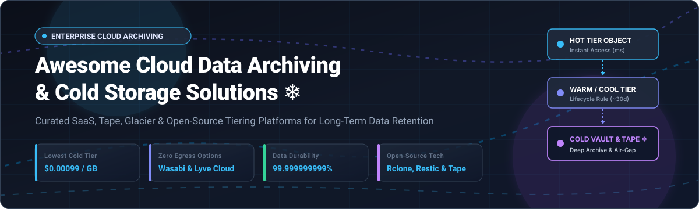

  

# ❄️ Awesome Long-Term Cloud Data Archiving & Cold Storage

  
  
  

> 🛡️ A curated directory of top **Long-Term Cloud Data Archiving**, **Cold Storage Services**, **Tape Vaulting**, and **Open-Source Data Tiering & Archival Backup Solutions** for cost-efficient, compliant retention of inactive petabyte-scale data.
>
> 🌟 Star this repo if you find it useful! 🌟

---

## 📋 Table of Contents

- [🌐 Sector Overview & Market Dynamics](#-sector-overview--market-dynamics)
- [🏢 Enterprise SaaS & Hosted Cold Storage Platforms](#-enterprise-saas--hosted-cold-storage-platforms)
- [🔓 Open-Source Software & Archival Pipelines](#-open-source-software--archival-pipelines)
- [📊 Comparison at a Glance](#-comparison-at-a-glance)
- [🎯 Key Selection Criteria for Cold Storage](#-key-selection-criteria-for-cold-storage)
- [⭐ Star History](#-star-history)
- [💖 Support](#-support)
- [🤝 Contributing](#-contributing)
- [📄 License](#-license)

---

## 🌐 Sector Overview & Market Dynamics

The global data archiving and cold storage market was valued at approximately **$6.5 billion in 2024** and is projected to expand to over **$24.8 billion by 2033**, compounding at an estimated CAGR of **16.2%**. This explosive growth is accelerated by petabyte-scale machine learning training datasets, generative AI audit logs, regulatory mandates (e.g., HIPAA, SEC Rule 17a-4, GDPR), and immutable air-gapped protection against ransomware.

Market concentration follows a **highly concentrated, oligopolistic structure** dominated by hyperscalers (Amazon AWS S3 Glacier, Microsoft Azure Archive Storage, Google Cloud Archive Storage) who command over 70% of cloud storage volume. However, a thriving **challenger tier** (such as Wasabi, Backblaze B2, Seagate Lyve Cloud, and Quantum) vigorously competes by eliminating complex retrieval egress charges and minimum-duration penalties, alongside robust **open-source data tiering tools** (like Rclone, Restic, MinIO, and HuskHoard) enabling hybrid multi-cloud and tape data sovereignty.

---

## 🏢 Enterprise SaaS & Hosted Cold Storage Platforms

The table below lists leading commercial cold storage providers, sorted in descending order by parent company market capitalization and annual run-rate valuation.

| Provider / Product 🏢 | Valuation / Revenue 💰 | Starting Pricing Tier 💵 | Free Tier / Trial Limit 🎁 | Storage Type 🗄️ | Retrieval SLA & Egress Notes ⚡ |
| :--- | :--- | :--- | :--- | :--- | :--- |
| **[Microsoft Azure Archive Storage](https://azure.microsoft.com/en-us/products/storage/blobs/)** | **~$3.1 Trillion** (Market Cap) | **$0.00099 / GB / month** (Archive tier, East US) | **12 Months Free Trial**: 5 GB LRS Blob storage/month + $200 initial credit (30 days) | Cloud Object Storage | Retrieval within 3–15 hours (High Priority: <1 hr); standard egress fees apply |
| **[AWS S3 Glacier Deep Archive](https://aws.amazon.com/s3/storage-classes/glacier/)** | **~$2.1 Trillion** (Amazon Market Cap) | **$0.00099 / GB / month** ($1.01 / TB / month) | **Free Forever Tier**: 5 GB standard S3 storage for 12 months (Free tier applies to S3 standard; Glacier retrieval free up to 10 GB/mo for Glacier Flexible standard retrieval) | Cloud Object / Deep Archive | Retrieval within 12–48 hours; lowest hyperscaler cost; standard AWS egress fees |
| **[Google Cloud Archive Storage](https://cloud.google.com/storage/docs/storage-classes#archive)** | **~$2.1 Trillion** (Alphabet Market Cap) | **$0.0012 / GB / month** (US regions) | **Free Forever**: 5 GB-months of Regional storage (US regions) + $300 credit for 90 days | Cloud Object Storage | Millisecond initial response, 365-day minimum storage; egress fees apply |
| **[Seagate Lyve Cloud](https://www.seagate.com/cloud/lyve-cloud/)** | **~$21 Billion** (Seagate Market Cap) | **$0.007 / GB / month** (~$7.00 / TB / month) | **30-Day Free Trial**: Up to 1 TB storage with full S3 API access | Cloud Object Storage | Zero egress fees; zero API call charges; built for mass data active archiving |
| **[Iron Mountain Cloud Archive](https://www.ironmountain.com/services/cloud-storage-and-services/iron-cloud-secure-offline-storage)** | **~$28 Billion** (Iron Mountain Market Cap) | **~$0.0025 / GB / month** (Secure Offline Storage) | **30-Day Free Proof of Concept (PoC)**: Evaluated upon sales consultation with sample archival dataset | Tape + Cloud Hybrid Vault | 24-hour physical tape retrieval SLA; zero egress fees; regulatory compliance |
| **[Druva Archival Storage](https://www.druva.com/products/long-term-retention/)** | **~$2 Billion+** (Private Valuation) | **~$2.50 / TB / month** (Long-Term Retention tier) | **30-Day Free Trial**: Up to 1 TB backup & archival data retention across SaaS/endpoints | Automated Cloud Tiering | Automated lifecycle migration to AWS Glacier Deep Archive / Azure Cold |
| **[Backblaze B2](https://www.backblaze.com/cloud-storage)** | **~$450 Million** (Public NASDAQ: BLZE) | **$0.006 / GB / month** ($6.00 / TB / month) | **Free Forever Plan**: 10 GB storage free forever + 1 GB download egress per day | S3-Compatible Cloud Storage | Free download egress up to 3x total stored data; no minimum duration limits |
| **[Wasabi Hot Cloud Storage](https://wasabi.com/)** | **~$1.4 Billion** (Private Valuation) | **$0.0069 / GB / month** ($6.99 / TB / month) | **30-Day Free Trial**: 1 TB of storage with unlimited read/write and API access | S3-Compatible Hot Cloud | No egress charges; no API request charges; 90-day minimum retention policy |
| **[Quantum ActiveScale](https://www.quantum.com/en/products/object-storage/)** | **~$250 Million** (Quantum Corp Enterprise) | **$0.003 / GB / month** (Cold Storage as-a-Service) | **30-Day Evaluation / Virtual Appliance PoC**: Provided for qualified on-premises deployments | On-Premises & Hybrid Tape/NVMe | S3 Glacier-compatible cold tape tier with up to 19 nines durability; zero internal egress |

---

## 🔓 Open-Source Software & Archival Pipelines

Open-source archival projects, self-hosted tools, and data-tiering solutions sorted by GitHub stargazer count. Each badge links directly to the project's stargazers community page.

| Project & Repository 📦 | GitHub Stars 🌟 | Primary Stack 🛠️ | License 📜 | Cold Storage Target 🎯 | Key Archival Features 🚀 |
| :--- | :--- | :--- | :--- | :--- | :--- |
| **[MinIO](https://github.com/minio/minio)** |  | Go | GNU AGPLv3 | Local Disks, S3, Azure, GCP, Cold Tiers | High-performance distributed S3 object store with automated lifecycle tiering to Glacier & cold clouds |
| **[Rclone](https://github.com/rclone/rclone)** |  | Go | MIT | 40+ backends (Glacier, B2, Wasabi, Azure) | The "rsync for cloud storage" with chunking, server-side copy, bandwidth throttling, and encryption |
| **[Restic](https://github.com/restic/restic)** |  | Go | BSD-2-Clause | AWS S3, B2, Azure, SFTP, REST server | Deduplicated, secure cryptographic snapshots with zero repository lock-in and immutable repository mode |
| **[Duplicati](https://github.com/duplicati/duplicati)** |  | C# / .NET | LGPL-2.1 | S3, B2, Glacier, OneDrive, WebDAV | Web-UI managed encrypted backup agent with block-level deduplication, incremental uploads, and scheduler |
| **[Kopia](https://github.com/kopia/kopia)** |  | Go | Apache-2.0 | S3, Google Cloud, Azure, B2, WebDAV | Fast end-to-end encrypted backup tool with content-addressable storage, snapshot retention, and GUI/CLI |
| **[BorgBackup](https://github.com/borgbackup/borg)** |  | Python / C | BSD-3-Clause | SSH/SFTP, Local Disk, Cloud via Rclone | Authenticated encryption, chunk-level deduplication, and append-only repository mode for air-gapping |
| **[Bup](https://github.com/bup/bup)** |  | Python / C | GPL-2.0 | Local Disk, Remote SSH | Git packfile format-based deduplicating archiver optimized for multi-terabyte virtual machine images |
| **[Bareos](https://github.com/bareos/bareos)** |  | C / C++ | AGPL-3.0 | LTO Tape Libraries, S3, Ceph, Disk | Enterprise tape library orchestration, multi-client scheduling, robotic jukebox management, and S3 tiering |
| **[S3QL](https://github.com/s3ql/s3ql)** |  | Python / C (FUSE) | GPL-3.0 | AWS S3, Google Storage, OpenStack Swift | Full POSIX-compliant filesystem mounted over object storage with transparent compression and deduplication |
| **[HuskHoard](https://github.com/HuskHoard/HuskHoard)** |  | Rust | Open Source | LTO Tape (SCSI), HDD, AWS S3 | Kernel-level `fanotify` data tiering; transparent file stubbing with StreamGate HTTP gateway for direct seeking |
| **[CERN Tape Archive (CTA)](https://github.com/cern-cta/CTA)** |  | C++ | GPL-3.0 | Enterprise Tape (IBM, Oracle, Spectra Logic) | Custodial exabyte-scale archival storage engine powering CERN's Large Hadron Collider (LHC) physics data |

---

## 📊 Comparison at a Glance

| Solution 🗂️ | License 📜 | Architecture 🏗️ | Storage Target 🎯 | Egress Fees 💸 | Self-Hosted 🏠 | Best For / Primary Use Case 💡 |
| :--- | :--- | :--- | :--- | :--- | :--- | :--- |
| **AWS Glacier Deep Archive** | Proprietary | Hyperscale Cloud | Cloud Cold Tier | ⚠️ Charged | ❌ No | Deepest compliance archive at lowest monthly cloud storage cost |
| **Azure Archive Storage** | Proprietary | Hyperscale Cloud | Cloud Cold Tier | ⚠️ Charged | ❌ No | Enterprise workloads deeply integrated into Microsoft 365 & Azure |
| **Google Cloud Archive** | Proprietary | Hyperscale Cloud | Cloud Cold Tier | ⚠️ Charged | ❌ No | BigQuery and GCP workflows requiring millisecond access to cold buckets |
| **Wasabi Hot Cloud** | Proprietary | Public Cloud | S3-Compatible Cloud | ✅ Zero (Fair use) | ❌ No | Active video streaming archives and high-read datasets without egress bills |
| **Backblaze B2** | Proprietary | Public Cloud | S3-Compatible Cloud | ✅ 3x Free / Low | ❌ No | Predictable, pay-as-you-go backups with no minimum retention penalties |
| **Seagate Lyve Cloud** | Proprietary | Public Cloud | Mass Object Storage | ✅ Zero | ❌ No | Mass petabyte-scale media & entertainment and AI model checkpoint archives |
| **Iron Mountain SOS** | Proprietary | Hybrid Cloud + Tape | Tape Vaulting | ✅ Zero | ❌ No | Maximum compliance retention requiring physical air-gapped tape vaulting |
| **Quantum ActiveScale** | Proprietary | Hardware / Appliance | NVMe + LTO Tape | ✅ Zero (Internal) | ✅ Yes | Sovereign, on-premises private cloud object storage with native cold tape tier |
| **Druva LTR** | Proprietary | Managed SaaS | AWS / Azure Cold | 🔄 Integrated | ❌ No | Automated policy-driven enterprise endpoint and VM snapshot archiving |
| **MinIO** | AGPL-3.0 | Distributed S3 | NVMe, HDD, Cloud Tier | ✅ Zero (Self-hosted) | ✅ Yes | Cloud-native private object store with automated lifecycle cloud tiering |
| **Rclone** | MIT | CLI Engine | 40+ Cloud Backends | ✅ Dependent on cloud | ✅ Yes | Multi-cloud data migration, synchronization, and automated archive jobs |
| **Restic** | BSD-2-Clause | Cryptographic CLI | S3, B2, Local, SFTP | ✅ Dependent on cloud | ✅ Yes | Tamper-proof, client-side encrypted backup pipelines to cold object stores |
| **Bareos** | AGPL-3.0 | Client-Server Suite | Tape, S3, Disk | ✅ Zero (Self-hosted) | ✅ Yes | Datacenter-scale robotic tape library management and cross-platform backup |
| **HuskHoard** | Open Source | Linux Kernel + Rust | LTO Tape, S3, HDD | ✅ Zero (Self-hosted) | ✅ Yes | Transparent OS-level cold data stubbing without FUSE filesystem performance hits |

---

## 🎯 Key Selection Criteria for Cold Storage

When architecting a cold data archive strategy, evaluate solutions against these critical operational pillars:

1. **Retrieval Latency SLA** ⏱️: Determine whether data retrieval can tolerate 3 to 48 hours (e.g., AWS Glacier Deep Archive, Azure Archive, Iron Mountain) or requires instantaneous millisecond retrieval (e.g., Wasabi, Google Cloud Archive, Backblaze B2).
2. **Minimum Storage Duration & Early Deletion Penalties** ⏳: Hyperscalers enforce minimum retention periods (AWS Deep Archive: 180 days; Google Archive: 365 days; Wasabi: 90 days). Deleting or overwriting before this duration results in pro-rated penalty charges.
3. **Data Egress & API Extraction Surcharges** 💸: Downloading multi-petabyte datasets from hyperscalers can result in catastrophic egress bills. Opt for zero-egress providers (Wasabi, Lyve Cloud) or CDN alliances (Backblaze B2 Bandwidth Alliance) for read-intensive archives.
4. **Immutability & Air-Gapped Ransomware Defense** 🔒: Ensure your platform supports Object Lock (WORM - Write Once, Read Many) compliant with SEC Rule 17a-4, or physical air-gap isolation via automated tape libraries (Bareos, Quantum, CTA, HuskHoard).
5. **Deduplication & Compression Ratios** 🗜️: Leveraging client-side deduplication engines (Restic, Borg, Kopia, S3QL) before transmitting payloads to cold tiers cuts required raw storage footprint by 40% to 80%.

---

##  Star History

---

## 💖 Support

Thank you for visiting and using this curated directory! If you find this project helpful or valuable for your cloud storage and data archiving projects, please consider supporting it:

- ⭐ **Star this repository** to improve discoverability for fellow architects and engineers
- 🍴 **Fork and contribute** new open-source archival tools, cloud storage providers, or benchmarks
- 📢 **Share** this collection with your DevOps, cloud engineering, and storage communities
- ☕ **Buy me a coffee / Sponsor**: If you'd like to support ongoing curation and maintenance of open-source knowledge bases, please check out the [GitHub Sponsors Dashboard](https://github.com/sponsors/ishandutta2007)

---

## 🤝 Contributing

Contributions are warmly welcomed! 🙌 If you know of an innovative open-source archiving tool, tape automation utility, or cold storage provider that belongs on this list:

1. 🍴 **Fork this repository**
2. 🌿 **Create a feature branch** (`git checkout -b feature/add-new-archiving-tool`)
3. ✍️ **Add the tool** with precise details (valuation/revenue, starting pricing, free tier limits, star badges)
4. 💾 **Commit your changes** (`git commit -m 'Add new open-source archival tool'`)
5. 🚀 **Push to the branch** (`git push origin feature/add-new-archiving-tool`)
6. 📬 **Submit a Pull Request**

---

## 📄 License

This repository is distributed under the [CC0 1.0 Universal (Public Domain)](https://creativecommons.org/publicdomain/zero/1.0/) license. Individual products, software packages, and tools mentioned retain their respective copyrights and licensing terms.

---

  <b>⭐ If this guide saves you storage costs or helps your data retention architecture, please star the repository! ⭐</b>

